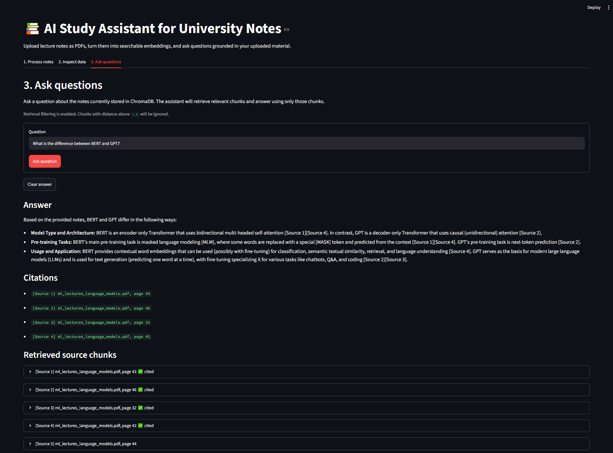
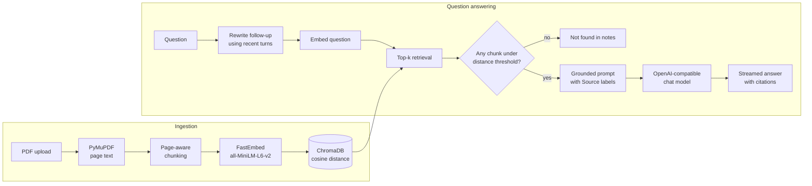
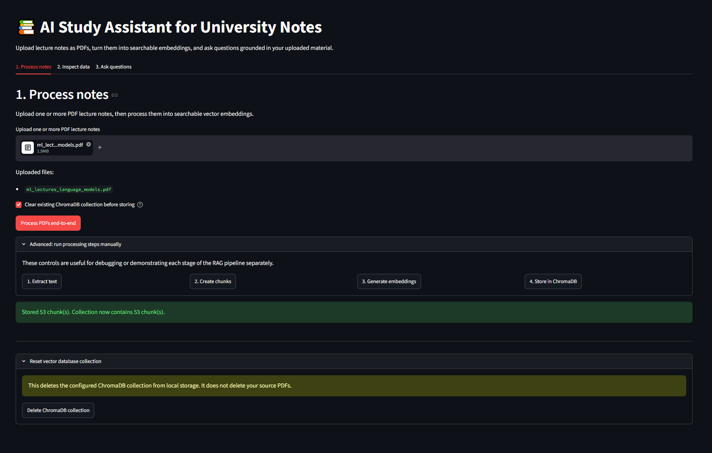

# AI Study Assistant

[](https://github.com/JesseSaarinen/AI-study-assistant/actions/workflows/ci.yml)
[](https://github.com/JesseSaarinen/AI-study-assistant/actions/workflows/evaluation.yml)

[](https://ai-study-assistant-jesse.streamlit.app)

Ask questions about your own lecture notes and get answers that cite the exact PDF page they came from. When the notes do not contain the answer, the assistant says so instead of guessing.

It is a retrieval-augmented generation (RAG) app built with Streamlit, ChromaDB, FastEmbed and any OpenAI-compatible chat API, including free tiers from Gemini and Groq.

**[Try the live demo](https://ai-study-assistant-jesse.streamlit.app)**: click **Try with sample notes**, then pick an example question. No account or API key needed. The app may take a minute to wake up if nobody has used it recently.



## Highlights

- **Grounded answers with page citations.** Answers cite `[Source N]` markers, and the UI shows the file, page and retrieved text behind each one.
- **A conversation, not a search box.** Follow-up questions such as "why is that?" are rewritten into standalone questions before retrieval, and answers stream in as they are generated.
- **Practice quizzes from your own notes.** Multiple-choice questions with explanations and page references, checked in the app and exportable as Anki flashcards.
- **Says "I could not find this in the uploaded notes."** when retrieval finds nothing relevant, without calling the chat model at all.
- **Measured, not guessed.** A labelled question set and an evaluation script compare embedding models, chunk sizes and distance thresholds, and the results set the app's defaults. A second script grades the answers themselves: refusals, citations, and an LLM judge for faithfulness. [Retrieval results](#retrieval-evaluation) and [answer evaluation](#answer-evaluation) below.
- **Light enough for free hosting.** Embeddings run on ONNX Runtime through FastEmbed, so the install is about 1 GB instead of 6.6 GB with PyTorch.
- **Ready for a public demo.** Bundled sample notes, one-click example questions, and a demo mode that isolates each visitor's notes and caps API usage.
- **Tested.** 183 pytest tests cover every module, the full pipeline and the Streamlit UI, with no network calls. CI runs ruff and the tests on every pull request and every push to `main`.

## How it works



1. **Extract.** PyMuPDF reads the selectable text of each page. Empty, oversized, non-PDF and scanned files are reported per file, so one bad upload does not stop the rest.
2. **Chunk.** Each page is split on its own into overlapping chunks that break at paragraph, sentence or word boundaries. Chunks never cross pages, so every chunk has exactly one page number to cite.
3. **Embed and store.** Chunks are embedded with `all-MiniLM-L6-v2`, normalised, and stored in ChromaDB with their file name and page number.
4. **Rewrite follow-ups.** When the conversation already has turns, the chat model rewrites the new question into a standalone one, so "why is that?" becomes "Why does a dynamic array double its capacity?". The rewritten question is shown above the answer.
5. **Retrieve.** The question is embedded the same way and the closest chunks are fetched. Chunks above `RETRIEVAL_DISTANCE_THRESHOLD` are dropped.
6. **Answer.** The remaining chunks go into a prompt that labels them `[Source 1]`, `[Source 2]` and so on, and tells the model to answer only from them. The answer streams into the chat as it is generated. If the model forgets to cite, the retrieved source labels are appended to the answer.

## Quick start

Requires Python 3.11 or newer.

```bash
git clone https://github.com/JesseSaarinen/AI-study-assistant.git
cd AI-study-assistant

python -m venv .venv
source .venv/bin/activate        # Windows: .\.venv\Scripts\Activate.ps1

pip install -r requirements-dev.txt
cp .env.example .env             # Windows: Copy-Item .env.example .env
```

Add an API key to `.env` (the file is git-ignored), then start the app:

```bash
streamlit run app.py
```

Open http://localhost:8501 and click **Try with sample notes**, or upload your own PDFs.

### Choosing a chat provider

The chat model is reached through the OpenAI Python client, so any OpenAI-compatible API works. Set these three values in `.env`:

| Provider | `OPENAI_BASE_URL` | Example `OPENAI_MODEL` | Cost |
|---|---|---|---|
| Google Gemini | `https://generativelanguage.googleapis.com/v1beta/openai/` | `gemini-3.5-flash-lite` | Free tier |
| Groq | `https://api.groq.com/openai/v1` | `llama-3.3-70b-versatile` | Free tier |
| Ollama (local) | `http://localhost:11434/v1` | `llama3.2` | Free, runs offline |
| OpenAI | `https://api.openai.com/v1` | `gpt-4o-mini` | Paid |

For Ollama, set `OPENAI_API_KEY` to any non-empty value such as `ollama`. Model names change often, so check your provider's current list.

## Using the app

The app has four tabs that follow the pipeline:

1. **Process notes.** Upload PDFs and process them end to end, or load the bundled sample notes. An advanced panel runs each stage on its own, which is handy for debugging or for showing how RAG works.
2. **Inspect data.** Browse the extracted pages, chunks, embedding vectors and the records stored in ChromaDB.
3. **Ask questions.** Chat about the stored notes and ask follow-up questions. Under each answer, a sources panel lists the citations and the retrieved chunks with their distance scores, with the cited ones marked.
4. **Practice.** Generate a multiple-choice quiz on a topic or across all of the notes. Checking the answers shows the score, an explanation and the source page for each question, and the questions download as a CSV that Anki and most flashcard apps import.



## Retrieval evaluation

[`scripts/evaluate_retrieval.py`](scripts/evaluate_retrieval.py) indexes the bundled sample notes and runs 38 labelled questions from [`eval/questions.json`](eval/questions.json): 30 that the notes answer, each labelled with the page that answers it, and 8 they cannot answer, including near misses such as B-trees and A* search. No API key is needed. The evaluation runs in GitHub Actions on every pull request that touches the pipeline, and the check fails if Hit@1 for the default setup drops below 90%. Full results are in [`eval/results.md`](eval/results.md).

| Embedding model | Chunk size | Hit@1 | Hit@3 | MRR |
|---|---:|---:|---:|---:|
| `all-MiniLM-L6-v2` (default) | 1000 | 97% | 100% | 0.98 |
| `all-MiniLM-L6-v2` | 1500 | 87% | 100% | 0.92 |
| `BAAI/bge-small-en-v1.5` | 1000 | 90% | 97% | 0.94 |
| `paraphrase-multilingual-MiniLM-L12-v2` | 1000 | 67% | 83% | 0.75 |
| `paraphrase-multilingual-MiniLM-L12-v2` | 300 | 83% | 97% | 0.89 |

Findings:

- **The default setup ranks the right page first for 29 of 30 questions.** Chunks of 300 to 1000 characters perform the same; at 1500, unrelated topics start sharing a chunk and Hit@1 drops to 87%.
- **The old distance threshold filtered almost nothing.** At 1.0 only 1 of the 8 unanswerable questions was rejected before reaching the chat model. At 0.8 every answerable question still finds its page and 3 of 8 are rejected; at 0.7, 6 of 8 are rejected at the cost of one answerable question. The default is now 0.8, a deliberately cautious choice because real notes are messier than this test set, and the prompt still tells the model to say when the context does not contain the answer.
- **Thresholds do not transfer between models.** `bge-small-en-v1.5` places every chunk within 0.5 of the question, so a threshold of 0.8 filters nothing for it.
- **The multilingual model is weaker on English notes and prefers small chunks.** If you use it for Finnish notes, try a `CHUNK_SIZE` of 300 to 500.

## Answer evaluation

Good retrieval does not guarantee a good answer, so [`scripts/evaluate_answers.py`](scripts/evaluate_answers.py) runs the same 38 questions through the full pipeline with a real chat model and grades every answer. Results of one run with `gemini-3.5-flash-lite` on the sample notes, with the same model as the judge (full report in [`eval/answer_results.md`](eval/answer_results.md)):

| Metric | Result | How it is measured |
|---|---:|---|
| Answer rate | 100% | Answerable questions that get an answer instead of the not-found reply. Checked against the labels. |
| Correct refusals | 100% | Unanswerable questions that get the not-found reply: 3 of 8 were filtered by distance before the chat model, and the model refused the other 5 itself. |
| Cites an expected page | 100% | Answers that cite at least one labelled page. |
| Citation precision | 100% | Cited `[Source N]` chunks that come from a labelled page. |
| Faithfulness | 1.00 | Mean judge score (1 supported, 0.5 partly, 0 unsupported). The judge checks every claim against the retrieved context, so a correct claim that is not in the notes still counts as unsupported. |
| Relevance | 1.00 | The same judge checks that the answer addresses the question. |

Findings:

- **The two refusal layers split the work.** The distance threshold stops clearly unrelated questions, such as the capital of Finland, without an API call. Near misses such as B-trees, A* search and tries pass the threshold, and the prompt makes the model say the notes do not cover them instead of answering from general knowledge.
- **No answer went beyond the notes.** Every answer cited a labelled page, and the judge found no claims outside the retrieved context.
- **Read 100% as "no problems found", not as a benchmark.** The test set is small and clean, and the judge grades its own model's answers (see [limitations](#limitations-and-next-steps)). The evaluation's job is to catch regressions when the prompt, the model or the retrieval settings change.

Refusals are graded by the labels alone, and the judge only sees answers. The script spaces out requests to stay within free tier limits; a full run with a free Gemini key takes about seven minutes. It runs in GitHub Actions on demand, from the Actions tab or by adding the `evaluate-answers` label to a pull request, using an `OPENAI_API_KEY` repository secret. `--pdf` and `--questions` point it at your own notes and labelled questions.

## Design decisions

- **Chunks never cross page boundaries.** It costs a little context at page edges, but every chunk maps to one page, so a citation always points to a page the student can open.
- **Cosine distance on normalised vectors.** Distances stay between 0 and 2 regardless of text length, which makes a single threshold meaningful across documents.
- **History rewrites the question, it does not answer it.** Earlier turns are used only to turn a follow-up into a standalone question. The answer prompt holds that question and freshly retrieved chunks, so every `[Source N]` the model sees belongs to the current answer, and a long conversation does not grow the prompt. If the rewrite fails, the original question is used.
- **Quizzes are checked in code, not trusted.** The model returns JSON, and every question is validated: exactly one option must match the stated answer, options must be distinct, and the cited passage must exist. Broken items are dropped instead of failing the quiz. The options are shuffled in code, because models tend to put the right answer in the same position. Without a topic, passages are drawn from as many different pages as possible so a quiz covers the whole set of notes.
- **Filter before the model, not after.** If no chunk is close enough, the app returns the not-found message without an API call. That is cheaper, and it removes the main source of hallucinated answers: weakly related context.
- **FastEmbed instead of Sentence Transformers.** The same model runs on ONNX Runtime, which removes PyTorch and its CUDA libraries from the install. Swapping models is one setting, and the evaluation script shows what each choice costs.
- **Any OpenAI-compatible API.** Free tiers and local models work with no code changes, which matters for students without a paid API account.
- **`src/` has no Streamlit imports.** The pipeline is plain Python, so the UI, the tests and the evaluation script all run the same code. Streamlit code lives in `ui/`, one module per tab.
- **Every model is behind a small protocol.** The embedding model and chat model are typed as minimal interfaces, so tests use deterministic fakes and never touch the network.

## Project structure

```text
AI-study-assistant/
├── app.py                  # Streamlit entry point
├── src/                    # RAG pipeline, no Streamlit imports
│   ├── pdf_loader.py        # PyMuPDF text extraction and validation
│   ├── chunker.py           # overlapping, page-aware text chunks
│   ├── embeddings.py        # FastEmbed (ONNX) embedding model wrapper
│   ├── vector_store.py      # ChromaDB storage and retrieval
│   ├── ingestion.py         # extract → chunk → embed → store
│   ├── prompts.py           # grounded answer and follow-up rewrite prompts
│   ├── rag_pipeline.py      # rewrite, retrieval and streamed answers
│   ├── citations.py         # [Source N] parsing and formatting
│   ├── quiz.py              # quiz generation, validation and flashcard export
│   ├── evaluation.py        # hit rate, MRR and threshold metrics
│   ├── answer_evaluation.py # refusal, citation and LLM judge metrics
│   ├── config.py            # environment-based settings with validation
│   ├── models.py            # dataclasses shared across modules
│   └── ui_helpers.py        # pure formatting helpers for the UI
├── ui/                     # Streamlit components, one module per tab
├── tests/                  # one test module per source module, plus app tests
├── eval/                   # labelled questions and the latest results
├── scripts/                # sample notes builder and evaluation scripts
├── sample_data/            # bundled sample lecture notes (PDF)
├── docs/                   # deployment guide and screenshots
├── .github/workflows/      # CI, retrieval evaluation and answer evaluation
├── requirements.txt        # runtime dependencies
├── requirements-dev.txt    # adds pytest and ruff
└── pyproject.toml          # pytest, coverage and ruff settings
```

## Configuration

All settings are environment variables, read from `.env` locally or from Streamlit secrets when hosted. See [`.env.example`](.env.example) for a commented template.

| Variable | Default | Purpose |
|---|---|---|
| `OPENAI_API_KEY` | | API key for the chat model |
| `OPENAI_BASE_URL` | `https://api.openai.com/v1` | OpenAI-compatible endpoint |
| `OPENAI_MODEL` | `gpt-4o-mini` | Chat model name |
| `EMBEDDING_MODEL_NAME` | `all-MiniLM-L6-v2` | Embedding model, any model FastEmbed supports |
| `CHUNK_SIZE` | `1000` | Maximum chunk length in characters |
| `CHUNK_OVERLAP` | `150` | Characters shared by neighbouring chunks |
| `TOP_K` | `5` | Chunks retrieved per question |
| `RETRIEVAL_DISTANCE_THRESHOLD` | `0.8` | Maximum cosine distance, or `disabled`. Tuned per model, see [results](eval/results.md) |
| `MAX_UPLOADED_FILE_MB` | `50` | Maximum size per PDF |
| `CHROMA_DB_DIR` | `storage/chroma` | Where ChromaDB stores its data |
| `CHROMA_COLLECTION_NAME` | `study_notes` | ChromaDB collection name |
| `DEMO_MODE` | `false` | Per-session collections and a question cap for public demos |
| `DEMO_MAX_QUESTIONS` | `20` | Questions per session in demo mode |
| `CHAT_HISTORY_TURNS` | `3` | Earlier turns used to rewrite follow-up questions, `0` turns rewriting off |

For notes in Finnish or other languages, set `EMBEDDING_MODEL_NAME=paraphrase-multilingual-MiniLM-L12-v2`, lower `CHUNK_SIZE` to around 500, and process the PDFs again. The distance of every retrieved chunk is shown in the UI, which helps when tuning the threshold for your own notes.

## Testing

```bash
pytest                                  # 183 tests, no network access needed
pytest --cov --cov-report=term-missing  # with coverage
ruff check . && ruff format --check .   # lint and format
python scripts/evaluate_retrieval.py    # retrieval evaluation, downloads the models
python scripts/evaluate_answers.py      # answer evaluation, needs a chat API key
```

The tests use small in-memory PDFs, a temporary ChromaDB and fake embedding and chat models. They cover PDF validation, chunking, embeddings, storage and retrieval, prompts, citations, configuration, the evaluation metrics, the full pipeline, and the Streamlit app through `AppTest`.

## Deployment

The app deploys for free on Streamlit Community Cloud with a free Gemini or Groq key. Step-by-step instructions are in [docs/DEPLOYMENT.md](docs/DEPLOYMENT.md).

## Limitations and next steps

- **Scanned PDFs** have no selectable text and need OCR, which is not included yet.
- **Slides and tables.** Slide decks produce short chunks, repeated headers and footers add noise, and tables, formulas and images are not interpreted.
- **Retrieval is vector only.** Hybrid keyword and vector search, or a reranker, would help with exact terms such as course codes.
- **The evaluation is small.** 38 questions on one short document, written by the same author as the notes, so the numbers are optimistic.
- **The judge is a language model.** By default it is the same model that wrote the answers, which tends to grade its own output generously. `--judge-model` lets a different model grade, and the report lists every flagged answer so the verdicts can be checked by hand.
- **Privacy.** Retrieved note text is sent to the configured chat provider. Use Ollama to keep everything on your machine.
- **Single user locally.** There are no accounts, and outside demo mode all notes share one collection.

Ideas for next steps: OCR for scanned notes, separate collections per course, deleting single documents, and spaced repetition for quiz questions answered wrong.

## License

This project is intended for educational and portfolio use.
